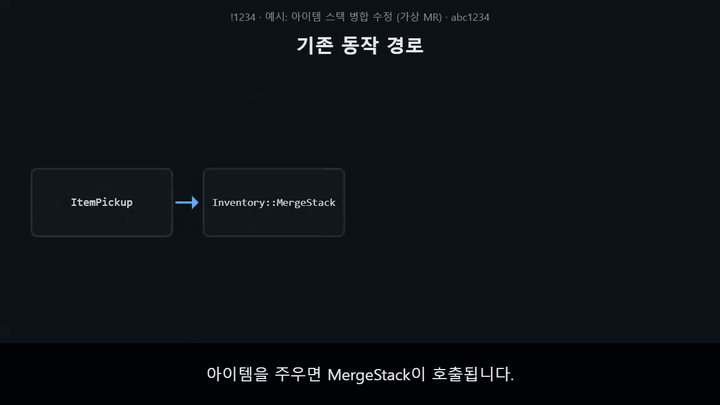

# Agent plugins for Claude Code, Codex, and Antigravity

This repository provides Aline Studio's Claude Code and Codex plugin marketplaces
and Antigravity packages. It contains independently installable plugins for
shared Claude guidance and optional OpenAI Codex routing, safe repository
search, X7-formatted commits, guarded Git maintenance, private intranet access,
VibeUE Unreal Engine MCP workflows, and subtitled GitLab MR explainer videos. Additional X7 plugins
can be added under `plugins/` without changing the marketplace identity.

Repository:
[studio-aline/agent-plugins](https://github.com/studio-aline/agent-plugins)

The marketplace name is `agent-plugins`. Individual plugins retain their own identifiers
and command namespaces, such as `guidance`, `/codex:*`, and `/git:*`.

## Plugins

### `guidance`

- Injects shared Claude model-selection and workflow guidance at session start,
  resume, `/clear`, compaction, and subagent start.
- Injects `codex-routing` as a conditional extension. It applies only when
  OpenAI's `codex@openai-codex` plugin is installed and enabled in Claude Code.
- Can be installed independently; it does not install the OpenAI plugin.

### `advisor`

- Consults GPT-6 Astra for one read-only second opinion before consequential
  complex work or when the user explicitly requests Advisor help.
- The consultation is root-agent-only. Subagents and the Advisor worker cannot
  invoke or proxy another Advisor consultation.
- Codex uses its native Astra subagent adapter; Claude Code can route that
  read-only consultation through `/codex:rescue` from OpenAI's
  `codex@openai-codex` plugin when it is installed and enabled.
- Antigravity publishes the skill and workflow but reports that no Astra
  adapter is available there rather than silently substituting another model.

### `ripgrep`

- `/ripgrep:search` — search file names and contents with `rg`, applying useful
  type/glob/context filters and returning concise `path:line` results.
- Respects `.gitignore`, hidden-file, and binary-file defaults unless the user
  explicitly asks to broaden the search.
- Blocks command-executing ripgrep options such as `--pre` and
  `--hostname-bin`, and does not grant blanket `Bash(rg *)` permission.

### `git`

- `/git:commit` — commit requested changes with the X7 GitLab issue message
  format only when the primary remote host matches `*.xlgames.com` or
  `*.xlgames.corp`; other repositories follow their own commit conventions. On
  X7 GitLab, derive the issue ID from a leading numeric branch prefix, ask
  whether to start programmer commit numbering at 1 when needed, and commit all
  `Generated` changes together last as `CodeGen`.
- `/git:rebase-master` — rebase the current branch onto local `master`, resolve
  conflicts from repository evidence, validate the result, and continue until
  complete.
- Does nothing when invoked from `master`.
- Refuses to discard or stash existing changes and never fetches, pushes,
  force-pushes, skips commits, or aborts the rebase automatically.

### `internal-web`

- `/internal-web:read` — read pages and API responses from HTTP(S) subdomains
  under `xlgames.com` or `xlgames.corp` using the developer's local network
  access.
- Prefers connected GitLab and Jenkins MCPs for `x7.xlgames.com` and
  `x7jenkins.xlgames.com`. Other pages use the active host's built-in browser
  when available, including Claude Desktop/Claude Code and ChatGPT Desktop/Codex.
- If sign-in is required, asks the user to enter credentials in the already-open
  embedded browser tab and waits there. It does not launch another browser for
  authentication or move credentials and cookies into chat or curl.
- Uses the bundled browser MCP and guarded curl wrapper only for pages that do
  not require sign-in when no host browser is available. The integrations
  validate allowed X7 subdomains, preserve TLS verification, limit response
  size, and reject unsafe redirects.

### `vibeue`

- `/vibeue:umg-inspect-bind` — resolve a Widget Blueprint name, inspect its UMG
  hierarchy and Blueprint graph references, and apply MVVM bindings, or wire
  Blueprint EventGraph nodes directly when MVVM binding alone is insufficient.
- `/vibeue:umg-mvvm-binding` — register MVVM ViewModels and manage property
  bindings and MvvmButton `SetCommand` command bindings.
- Connects to the [VibeUE](https://github.com/kevinpbuckley/VibeUE) MCP server
  running inside a local Unreal Editor (`http://127.0.0.1:8088/mcp` by
  default) through `mcp-remote`. Refuses to fall back to manual `.uasset`
  binary inspection when the MCP tools are unavailable.

### `mr-video`

- `/mr-video:mr-video` — render a subtitle-only explainer video of the author's
  own GitLab MR change and embed it at the top of the MR description. Runs only
  when explicitly requested.
- Uses the MR description as primary material: mermaid diagrams (with
  per-caption node emphasis), before/after code, comparison tables, terminal
  commands, and test results.
- Checks every code scene against the real base/head commits, QA's the encoded
  MP4, changes the MR only after a successful upload, replaces only its marker
  block, and verifies the saved description byte for byte.
- Saves the description through a GitLab MCP when the host has one (Claude
  Code) and through the GitLab API otherwise (Codex).
- Windows only. Installs its own npm dependencies (Revideo, mermaid, headless
  Chromium) under `plugins/mr-video/scripts/` on first use.



## Prerequisites

- Claude Code 2.1.128 or newer.
- Git on `PATH` for the `git` plugin.
- A host-provided built-in browser for authenticated `internal-web` pages. If
  it is unavailable and a page is known not to require sign-in, Chrome, Edge,
  or Whale can serve as the optional local browser MCP; select it with
  `X7_INTERNAL_BROWSER` or set `X7_INTERNAL_BROWSER_PATH` for a custom binary.
- curl on `PATH` for the unauthenticated `internal-web` fallback (`curl.exe` on
  Windows).
- ripgrep on `PATH` for the `ripgrep` plugin (`rg --version` to verify).
- `npx` on `PATH` and a running Unreal Editor with the VibeUE plugin loaded
  for the `vibeue` plugin. Its MCP server defaults to port `8088`; override
  with `VIBEUE_MCP_PORT` if the project's VibeUE proxy uses a different port.
- Windows, Node.js with npm, and Git on `PATH` for the `mr-video` plugin, plus
  `GITLAB_HOST` and `GITLAB_TOKEN` (a PAT with `api` scope) set for uploads.

For Claude Code Codex delegation, install OpenAI's [Codex plugin for Claude
Code](https://github.com/openai/codex-plugin-cc) separately. X7's routing and
Advisor guidance do not activate that integration unless `codex@openai-codex`
is installed and enabled.

## Installation

### Claude Code

Run the following commands in Claude Code:

```text
/plugin marketplace add studio-aline/agent-plugins
/plugin install guidance@agent-plugins
/plugin install advisor@agent-plugins
/plugin install ripgrep@agent-plugins
/plugin install git@agent-plugins
/plugin install internal-web@agent-plugins
/plugin install vibeue@agent-plugins
/plugin install mr-video@agent-plugins
/reload-plugins
```

Install `guidance@agent-plugins` directly when only the shared Claude policy is needed.
Install OpenAI's `codex@openai-codex` plugin separately to activate the
conditional Codex routing guidance:

```text
/plugin marketplace add openai/codex-plugin-cc
/plugin install codex@openai-codex
/reload-plugins
/codex:setup
```

Invoke the installed skills as follows:

```text
/advisor:advisor review this multi-file refactor before I start
/ripgrep:search find all references to a symbol in the source code
/git:commit 12345번 이슈, 프로그래머 커밋 번호 2
/git:rebase-master
/internal-web:read https://x7jenkins.xlgames.com/job/example/api/json summarize the build status
/vibeue:umg-inspect-bind Get full hierarchy of QuestViewBP and expand all BP references
/vibeue:umg-mvvm-binding Register GameHUDViewModel as HudVM and bind HealthPercent to HealthBar.Percent
/mr-video:mr-video MR에 설명 영상 넣어줘 https://<GitLab 호스트>/group/project/-/merge_requests/1234
```

OpenAI's `/codex:rescue`, `/codex:review`, and `/codex:adversarial-review`
commands are available only after that plugin is installed and enabled. The
X7 `codex-routing` extension remains inactive otherwise.

### Codex

The `advisor`, `ripgrep`, `git`, `internal-web`, `vibeue`, and `mr-video`
plugins are also packaged for Codex. The Claude `guidance` plugin is omitted from the Codex
marketplace because its session hooks and optional OpenAI plugin integration
target Claude Code.

Install the marketplace and plugins from a terminal with a Codex CLI version
that supports the `codex plugin` commands:

```powershell
codex plugin marketplace add studio-aline/agent-plugins
codex plugin add advisor@agent-plugins
codex plugin add ripgrep@agent-plugins
codex plugin add git@agent-plugins
codex plugin add internal-web@agent-plugins
codex plugin add vibeue@agent-plugins
codex plugin add mr-video@agent-plugins
codex plugin list
```

Restart Codex after installation so the newly installed skills are loaded.
Invoke the installed Codex skills as `$advisor`, `$search`, `$commit`,
`$rebase-master`, `$read`, `$umg-inspect-bind`, `$umg-mvvm-binding`, and
`$mr-video`. Use
`$advisor` when an explicit Astra review is needed.

### Antigravity

Antigravity plugins in this repository are installed at workspace scope. Clone
the repository, then open its root directory as the workspace in Antigravity:

```powershell
git clone https://github.com/studio-aline/agent-plugins.git
cd agent-plugins
```

Antigravity discovers the generated packages from `.agents/plugins/` and the
workspace marketplace at `.agents/plugins/marketplace.json`. Restart or reload
the Antigravity workspace if it was already open when the repository was
cloned. The `antigravity-guidance` plugin supplies an Antigravity-specific
`model-routing` table. The `advisor` skill is packaged for workflow discovery
but reports that no Astra adapter is available on this host, while `ripgrep`,
`git`, `internal-web`, and `vibeue`
expose the same shared skills as Claude Code and Codex.

`mr-video` is not packaged for Antigravity: it is published for Claude Code and
Codex only, by request, and has no Antigravity package or Workflow wrapper.

Use `/skills` in Antigravity CLI to confirm that the skills are loaded. In
Antigravity GUI, confirm that `/model-routing`, `/advisor`, `/search`, `/commit`,
`/rebase-master`, `/read`, `/umg-inspect-bind`, and `/umg-mvvm-binding` appear
in slash completion. These workspace Workflow wrappers select the
corresponding canonical skills and preserve their safety constraints.

The canonical sources remain under `plugins/`. After editing a shared skill or
resource, regenerate and verify the Antigravity packages:

```powershell
npm run sync:antigravity
npm run validate:antigravity
```

## Updating plugins

### Claude Code

Refresh the marketplace, then update each installed plugin. Omit plugins that
are not installed:

```powershell
claude plugin marketplace update agent-plugins
claude plugin update guidance@agent-plugins
claude plugin update advisor@agent-plugins
claude plugin update ripgrep@agent-plugins
claude plugin update git@agent-plugins
claude plugin update internal-web@agent-plugins
claude plugin update vibeue@agent-plugins
claude plugin update mr-video@agent-plugins
```

Restart Claude Code after the updates are complete. Update the separately
installed OpenAI Codex plugin through its own marketplace when needed.

### Codex

Refresh the Git marketplace snapshot. Installed X7 plugins refer to that
snapshot, so a separate install command is not required:

```powershell
codex plugin marketplace upgrade agent-plugins
codex plugin list
```

Restart Codex after the marketplace upgrade so the refreshed skills are
loaded. If a new X7 plugin was added to the marketplace, install it separately
with `codex plugin add <plugin>@agent-plugins`.

### Antigravity

Update the cloned workspace repository, then reload the workspace:

```powershell
git pull --ff-only
```

Antigravity reloads the updated packages from `.agents/plugins/` and Workflow
wrappers from `.agent/workflows/`. Use `/skills` in Antigravity CLI or slash
completion in Antigravity GUI to confirm that the updated skills are loaded.

## Local development

Clone the repository:

```powershell
git clone https://github.com/studio-aline/agent-plugins.git
cd agent-plugins
claude --plugin-dir .\plugins\guidance
claude --plugin-dir .\plugins\advisor
claude --plugin-dir .\plugins\ripgrep
claude --plugin-dir .\plugins\git
claude --plugin-dir .\plugins\internal-web
claude --plugin-dir .\plugins\vibeue
claude --plugin-dir .\plugins\mr-video
```

On macOS or Linux, use:

```bash
claude --plugin-dir ./plugins/guidance
claude --plugin-dir ./plugins/advisor
claude --plugin-dir ./plugins/ripgrep
claude --plugin-dir ./plugins/git
claude --plugin-dir ./plugins/internal-web
claude --plugin-dir ./plugins/vibeue
claude --plugin-dir ./plugins/mr-video
```

## Team distribution

Team members can add `studio-aline/agent-plugins` as a marketplace and
install any plugin using the commands above. For repository-guided installation,
add the marketplace and desired plugins to the consuming repository's
`.claude/settings.json`:

```json
{
  "extraKnownMarketplaces": {
    "agent-plugins": {
      "source": {
        "source": "github",
        "repo": "studio-aline/agent-plugins"
      }
    }
  },
  "enabledPlugins": {
    "advisor@agent-plugins": true,
    "ripgrep@agent-plugins": true,
    "git@agent-plugins": true,
    "internal-web@agent-plugins": true,
    "vibeue@agent-plugins": true,
    "mr-video@agent-plugins": true
  }
}
```

Enable `guidance@agent-plugins` for shared Claude guidance. Install and enable
`codex@openai-codex` separately to activate its Codex-routing extension.

## Development

```powershell
npm test
npm run validate:antigravity
npm run validate:codex
claude plugin validate .
```

Apart from `mr-video`, the plugins have no npm runtime dependencies. `mr-video`
installs its own into `plugins/mr-video/scripts/` on first use (`node
plugins/mr-video/scripts/bin/setup.mjs`); see `plugins/mr-video/README.md` for its
own tests.
